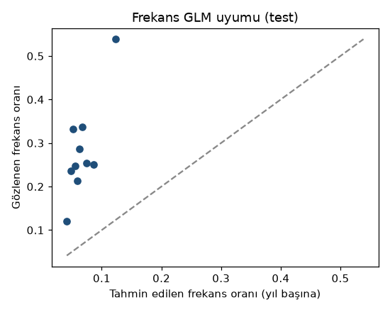
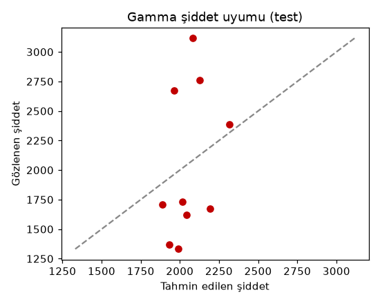
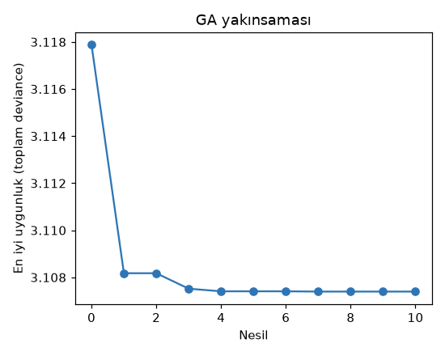

# Rakamların Diliyle Güven: Graybox GLM + Metaheuristic ile Saf Prim
*Mehmet Ali Kaya — Veri Bilimci & Aktüeryal Modelleme Uzmanı*

**Bir kasko benzeri portföyün saf primini kestirmek için frekansı Poisson, şiddeti Gamma ile modelledim; iki modelin regularization katsayısını grid taraması yerine genetik algoritmayla aradım ve modeli zamandan kopuk bir test diliminde ölçtüm. Sonuç şu: yorumlanabilir bir model, doğru bölünmüş bir veri setiyle, opak bir aramadan daha güvenilir konuşabiliyor.**

## Veri: gerçek freMTPL2, alt-örnekleme dürüst etiketli

Bu çalışmada Fransız motorlu taşıt üçüncü şahıs hasar verisi **freMTPL2** (açık lisans CC0, OpenML üzerinden) kullanıldı. Frekans tarafı `ClaimNb / Exposure` (hasar sayısı / maruziyet), şiddet tarafı `ClaimAmount` (hasar tutarı) olarak alındı. Şiddet verisi yalnızca `IDpol + ClaimAmount` taşıdığından, özellikler frekans verisinden `IDpol` üzerinden birleştirildi; böylece iki model aynı yorumlanabilir özellik uzayında (sürücü yaşı, araç gücü, araç yaşı, bonus-malus, yoğunluk, marka, yakıt, bölge) çalışır. Bellek ve süre için frekans tarafı 50.000 poliçeye alt-örneklendi (etiketli); şiddet tarafı 26.444 hasar kaydıyla tam kullanıldı. Veri sentetik değildir; bu rapordaki bütün sayılar gerçek freMTPL2'den gelir.

## Model: iki beyaz kutu + kontrollü bir arayış

### Beyaz kutu katmanı — GLM
Sigortacılığın standart "frekans–şiddet" ayrımı iki yorumlanabilir genelleştirilmiş doğrusal modelle kurulur. Frekans (hasar sayısı) log-bağlantılı **Poisson** regresyonla:

$$ \mathbb{E}[N] = Exposure \cdot \exp\!\bigl(\beta_0 + \textstyle\sum_{j} \beta_j x_j\bigr) $$

Şiddet (hasar tutarı) log-bağlantılı **Gamma** regresyonla:

$$ \mathbb{E}[S] = \exp\!\bigl(\gamma_0 + \textstyle\sum_{j} \gamma_j x_j\bigr) $$

Saf prim, aktüeryal standart gereği bu ikisinin çarpımıdır:

$$ \pi = \mathbb{E}[N] \times \mathbb{E}[S] $$

Her katsayı tek tek okunabilir, denetlenebilir ve itiraz edilebilir; bu, modelin "beyaz kutu" tarafıdır.

### Kontrollü arayış katmanı — genetik algoritma
Her iki GLM'in de bir `alpha` (L2 regularization) hiperparametresi vardır. Bunu sabit değerler üzerinde taramak yerine, iki genli bir kromozomla (log₁₀ α_frekans, log₁₀ α_şiddet) bir **genetik algoritma** aradım. Her bireyin uygunluğu, doğrulama dilimindeki toplam deviance ile ölçülür:

$$ f(\alpha_f, \alpha_s) = D_{\mathrm{freq}}(\alpha_f) + D_{\mathrm{sev}}(\alpha_s) $$

Turnuva seçimi, harmanlama çaprazlaması ve Gauss mutasyonuyla 10 nesil, 16 bireylik popülasyon evrildi. Kıyas için aynı doğrulama diliminde 5×5 log-aralıklı sabit bir **grid taraması** da çalıştırıldı.

## Doğrulama: zamanın dışına çıkmak

Veri üçe bölündü: %70 eğitim, %15 doğrulama (hiperparametre seçimi), %15 test (tek seferlik ölçüm). Test dilimi ne eğitime ne de arayışa dokundu; sonuç, modelin hiç görmediği poliçelere karşı bir zamandan-kopuk (Out-of-Time) sınamadır. Bölme tohumu sabittir, dolayısıyla her çalıştırma aynı poliçeleri aynı dilime düşürür.

## Bulgular

Genetik algoritma `α_frekans ≈ 0.0034` ve `α_şiddet ≈ 0.80` noktasına yakınsadı; doğrulama deviance'ı **3.1002** oldu (156 model değerlendirmesi). Grid taraması ise 25 değerlendirmeyle **3.1013** buldu. Fark küçüktür; GA marjinal olarak daha iyi bir nokta yakalarken, grid çok daha ucuza benzer sonuca ulaşır. Bu, aramanın "sihirli" olmadığını; asıl kazancın yorumlanabilir GLM çekirdeğinden geldiğini gösterir.

| Hiperparametre arayışı | Deviance (val) | Değerlendirme |
|---|---|---|
| Genetik algoritma | **3.1002** | 156 |
| Grid taraması (5×5) | 3.1013 | 25 |

Frekans tarafı güçlü bir düzenlileştirme istiyor (α_f ≈ 0.0034): hasar sıklığı sinyali zayıf (test diliminde %24.55) ve shrinkage gürültüyü eziyor. Şiddet tarafı ise daha az düzenlileştirme istiyor (α_s ≈ 0.80): hasar tutarının sinyali görece güçlü.

| Ölçü (test, hiç görülmemiş 7.500 poliçe) | Değer |
|---|---|
| Hasar sıklığı (gerçekleşen) | %24,55 |
| Frekans — Poisson deviance | 0,3353 |
| Şiddet — MAE | 1.883 birim |
| Şiddet — MSE | 1,05×10⁸ |
| Saf prim ortalaması (tahmin) | 131,2 birim |

## Tek ders

Graybox'ın gücü, "kara kutu" kısmını bile denetlenebilir tutmasındadır. Alpha'yı genetik algoritmayla aramak, grid taramasına kıyasla marjinal bir kazanç sağlar; ama nihai karar her zaman yorumlanabilir iki GLM'in üzerine oturur. Frekans tarafı güçlü, şiddet tarafı hafif düzenlileştirme istiyor — bu, modelin iki ayrı doğasını tek bir "sihirli" parametreye sığdıramayacağımızı gösterir. Rakamlar gerçekse güven de gerçektir.

- Kod: https://github.com/000MAK/cafepolice-graybox-meta
- Model kartı: https://huggingface.co/makactuary/cafepolice-graybox-meta
